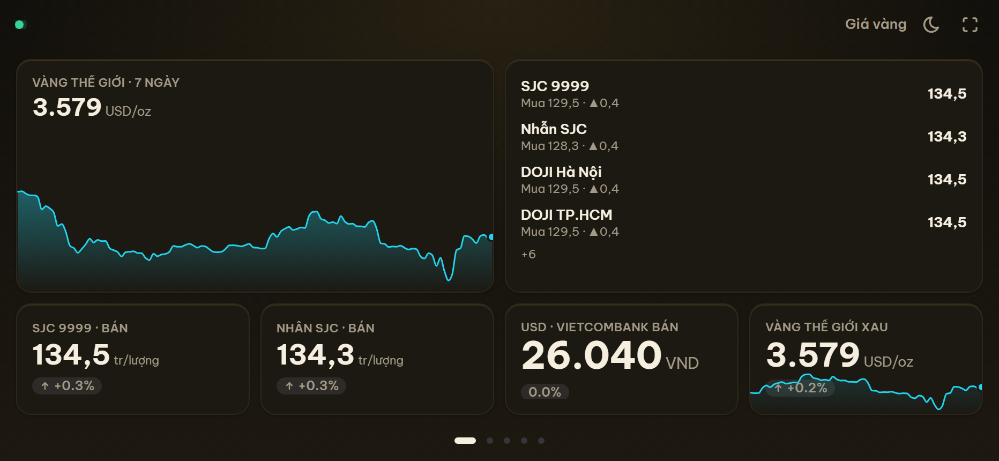
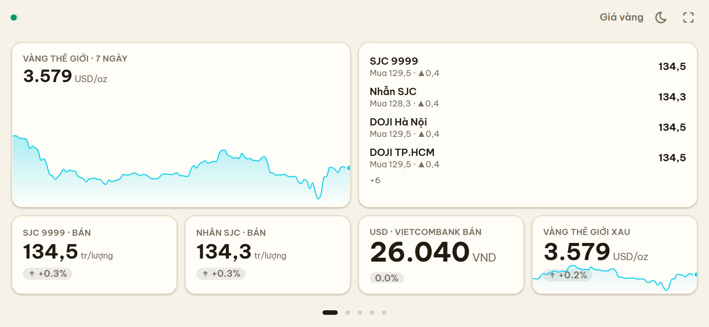

# Kim

A Nookdeck theme pack: **Đêm** (Night, dark) and **Ngày** (Day, light), with three accent choices (gold, jade, lacquer red). Warm gold on deep ink, with a faint light from the top of the screen and a thin gold edge on each tile.

- Set in **Be Vietnam Pro** for text and numbers, so Vietnamese diacritics and big numbers read cleanly. Numbers use even-width digits, so prices do not jump around when they change.
- Original design by anionzo. Licence: MIT, in [LICENSE](LICENSE).
- Font: [Be Vietnam Pro](https://github.com/bettergui/BeVietnamPro) Regular, SemiBold and Bold, cut down to Latin and Vietnamese. SIL Open Font License 1.1, in [LICENSE-OFL-BeVietnamPro.txt](LICENSE-OFL-BeVietnamPro.txt).
- CSS only: no scripts and no animation. Works in lite mode and with reduced motion.

| Đêm | Ngày |
|---|---|
|  |  |
